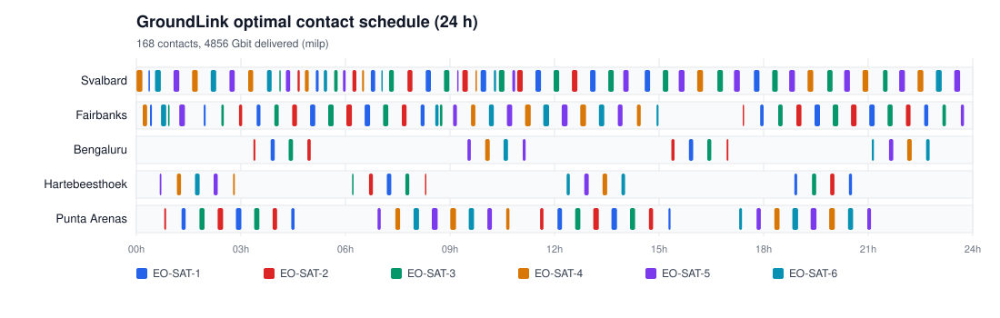
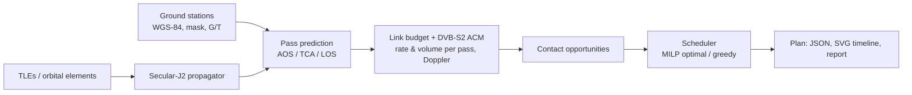

# GroundLink

**Ground-station contact planning and optimal downlink scheduling for satellite constellations.**

[](https://github.com/cheeranjivkumar909-blip/groundlink/actions/workflows/ci.yml)


Earth-observation constellations generate far more data than they can bring
down. Every operator, and every ground-station-as-a-service provider, has to
decide daily which satellite talks to which antenna and when. GroundLink
answers that end to end:

1. **When can we talk?** Predicts every pass of every satellite over every
   station (AOS / LOS to 1 ms, culmination, azimuths).
2. **How much can we bring down?** Runs a physics-based X-band link budget
   through each pass with DVB-S2 adaptive coding and modulation, giving the
   data rate second by second and the volume per pass. It also gives the
   Doppler profile for receiver tuning.
3. **Who gets which antenna?** Solves the contact-assignment problem to proven
   optimality as a mixed-integer program. It respects antenna slew/set-up time,
   one contact per antenna and per satellite, on-board data backlogs and
   mission priorities.



```text
$ groundlink demo
GroundLink - Ground-Station Contact Planning & Downlink Scheduling
========================================================================
Constellation : 6 EO satellites, 2 sun-synchronous planes (520/560 km)
Network       : 5 X-band stations | horizon 24 h from 2026-12-01T00:00:00.000Z
Link          : 8.2 GHz, EIRP 9 dBW, 25 Msps, DVB-S2 ACM (23 MODCODs)
------------------------------------------------------------------------
Station          Passes  Contact [min]  Mean max-el  Volume [Gbit]
Svalbard             81          656.8        38.3°         2899.3
Fairbanks            60          432.7        25.9°         1563.6
Bengaluru            16           97.7        33.8°          377.7
Hartebeesthoek       18          105.6        34.7°          440.5
Punta Arenas         32          252.2        30.2°          807.9
Total candidate contacts: 207 | offered volume 6089 Gbit
------------------------------------------------------------------------
EXAMPLE PASS
  EO-SAT-4 over Svalbard: AOS 2026-12-01T00:00:21.040Z  LOS 2026-12-01T00:10:25.292Z  (10.1 min)
  Max elevation 77.7° | max Doppler ±191 kHz | peak rate 89.2 Mbit/s | volume 47.4 Gbit
------------------------------------------------------------------------
SCHEDULE                Contacts  Delivered [Gbit]  Weighted value  Solve [s]
Greedy heuristic             162            4787.8          6202.0      0.003
Optimal (MILP)               168            4856.2          6280.1      0.028
Optimiser gain over greedy: +1.3 % weighted value, +68.4 Gbit
------------------------------------------------------------------------
```

On an oversubscribed network (6.5 Tbit of on-board backlog against 6.1 Tbit of
pass capacity, and only one satellite per antenna at a time), the optimiser delivers **68 Gbit/day more** than a well-tuned
priority-greedy baseline. The whole 24 h plan, from orbits to optimal
schedule, takes **about one second** on a laptop.

---

## Why this matters

Ground segment capacity is a growing bottleneck for NewSpace. Satellites are
cheaper to launch than ever, but antenna time at good high-latitude sites is
scarce and expensive. Every unused minute is data that ages on board or never
reaches the customer. Today scheduling is often done with spreadsheets or
first-come-first-served rules. GroundLink is a transparent, tested planning
core that a constellation operator or a ground-station network can embed and
extend.

| Who | Use |
| --- | --- |
| EO / IoT constellation operators | Daily downlink plans that maximise delivered data and respect priorities |
| Ground-station-as-a-service providers | Antenna allocation across customers, capacity planning for new sites |
| Mission designers | Data-throughput budgets: which orbit, which stations, which link parameters |
| Universities / CubeSat teams | Pass prediction, Doppler and link budgets for a single station |

## Features

- **Orbit propagation**: Kepler + J2 secular drift, vectorised over thousands of epochs; TLE ingestion with checksum validation.
- **Earth model**: WGS-84 geodetic stations, IAU-82 GMST Earth rotation, ECEF velocities including the rotating-frame term.
- **Pass prediction**: elevation-mask crossings refined with Brent's method, culmination by bounded optimisation.
- **RF link budget**: free-space loss, elevation-dependent atmospheric loss, G/T, C/N0 to Es/N0, and **DVB-S2 ACM** across 23 MODCODs with an implementation margin.
- **Doppler**: per-second frequency offset profile (±191 kHz at X-band for LEO).
- **Optimal scheduling**: MILP (HiGHS via SciPy) with clique constraints for antennas and satellites, set-up times, on-board backlogs and priorities; plus a greedy baseline for comparison.
- **Outputs**: console report, JSON schedule, dependency-free SVG Gantt timeline.
- **23 tests** in CI on Python 3.10 - 3.13.

## Architecture



```
src/groundlink/
  constants.py    WGS-84 and RF constants
  elements.py     Kepler's equation, elements <-> state vectors
  tle.py          TLE parsing / validation / generation
  propagation.py  Kepler + J2 secular propagator
  frames.py       GMST, ECI -> ECEF, geodetic, look angles
  stations.py     ground-station model and demo network
  link.py         FSPL, Doppler, C/N0, DVB-S2 ACM data rate
  passes.py       pass prediction and per-pass profiles
  scheduler.py    MILP and greedy contact scheduling
  planner.py      end-to-end planning problem and demo constellation
  timeline.py     SVG Gantt chart
  cli.py          command-line interface
```

## Quick start

```bash
git clone https://github.com/cheeranjivkumar909-blip/groundlink.git
cd groundlink
pip install -e ".[dev]"

groundlink demo --svg schedule.svg --json schedule.json
pytest
```

Predict passes of any TLE over a station:

```bash
groundlink passes examples/sample.tle --station Bengaluru --hours 24
groundlink passes examples/sample.tle --lat 28.61 --lon 77.21 --min-el 10   # any site
```

Use it as a library:

```python
from groundlink import demo_problem, build_opportunities, schedule_optimal

problem = demo_problem(hours=24)
contacts = [o.contact for o in build_opportunities(problem)]
plan = schedule_optimal(contacts, [s.demand for s in problem.satellites], setup_s=120)
print(plan.total_delivered_gbit, len(plan.contacts))
```

## Methodology

**Look angles.** Satellite ECI states are rotated to ECEF with GMST,
`v_ecef = R v_eci - ω × r_ecef`. The topocentric vector is projected on the
station's East-North-Up basis to get azimuth, elevation, range and range-rate.

**Link budget.**
`C/N0 = EIRP - FSPL(d, f) - L_atm/sin(el) - L_misc + G/T + 228.6`,
`Es/N0 = C/N0 - 10 log10(Rs)`. The highest-efficiency DVB-S2 MODCOD whose
threshold plus margin is met sets the information rate `Rs · η`. The volume
per pass is the time integral of the rate from AOS to LOS.

**Scheduling.** Binary `x_i` selects contact *i*; continuous `y_s` is the data
delivered for satellite *s*.

```
maximise    Σ_s w_s y_s  −  ε Σ_i x_i
subject to  y_s ≤ Σ_{i ∈ s} V_i x_i,      0 ≤ y_s ≤ B_s
            Σ_{i ∈ K} x_i ≤ 1              for every clique K of overlapping contacts
                                            on one antenna (incl. set-up time) or one satellite
```

Because contact conflicts on a single resource form an interval graph, the
maximal cliques are exactly the sets of intervals containing some interval's
start time. This gives a compact, tight formulation that HiGHS solves in
milliseconds for a day of a six-satellite, five-station problem.

## Validation

| Test | Criterion |
| --- | --- |
| GMST at J2000 and Vallado Example 3-5 | 280.4606° / 152.5788° (< 1e-4°) |
| WGS-84 geodetic -> ECEF | equator, pole (b = 6356.752 km), 1 km altitude |
| Look angles | 90° elevation overhead; azimuth 0° north, 90° east |
| ECEF velocity | inertially fixed point moves at ω·r |
| Free-space path loss | 159.30 dB at 2.2 GHz, 1000 km |
| Doppler | ±191 kHz at 8.2 GHz, 7 km/s; positive on approach, negative on recession |
| ACM | efficiency non-decreasing in Es/N0; link closes below threshold |
| Passes | Svalbard sees 10-16 passes/day of an SSO satellite; elevation = mask at AOS/LOS |
| Scheduler | MILP beats greedy on the classic interval counter-example (12 vs 10) |
| Constraints | no antenna / satellite / set-up conflicts; backlogs respected; MILP ≥ greedy |

## Limitations and roadmap

- J2-secular propagation (seconds-level pass timing). **Next:** SGP4 and CCSDS OEM ephemerides.
- Rain fade not modelled (ITU-R P.618). **Next:** site-specific availability statistics.
- Whole-pass contacts only. **Next:** partial-pass contacts, multi-antenna sites, uplink windows.
- **Next:** rolling-horizon re-planning, REST API and an operator dashboard.

## References

1. D. A. Vallado, *Fundamentals of Astrodynamics and Applications*, 4th ed., Microcosm Press, 2013.
2. ETSI EN 302 307-1, *Digital Video Broadcasting (DVB); Second generation framing structure... (DVB-S2)*.
3. CCSDS 401.0-B, *Radio Frequency and Modulation Systems - Part 1: Earth Stations and Spacecraft*.
4. M. C. Golumbic, *Algorithmic Graph Theory and Perfect Graphs*, 2004 (interval-graph cliques).

The ground-station sites are approximate public locations with generic antenna
assumptions. The network is illustrative and does not represent any operator.

## License

MIT - see [LICENSE](LICENSE).
